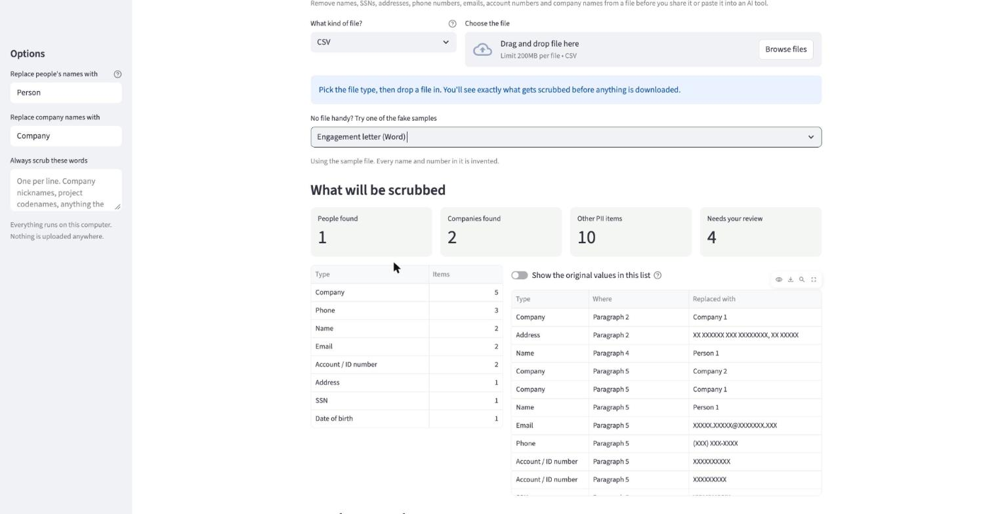

# PII Scrubber

A small app that runs on your own computer and removes personal information from CSV, Excel, Word and PDF files before you share them or paste them into an AI tool.

It replaces people's names with Person 1, Person 2, ... and company names with Company 1, Company 2, ... Everything else (SSNs, addresses, phone numbers, emails, account numbers, dates of birth) is X'd out in a way that keeps the shape, so XXX-XX-XXXX still reads as an SSN. Dollar amounts, hours, rates and dates that aren't birthdays are left alone.

Nothing leaves your machine. There is no server, no account and no internet traffic once it's installed.

**Download:** [pii-scrubber.zip](https://github.com/joedilloncpa/pii-scrubber/releases/latest/download/pii-scrubber.zip) (latest release, no GitHub account needed)



## The easy way: let your AI assistant install it

If you use Claude (or another AI assistant that can run things on your computer), paste this:

> Install the PII Scrubber on my computer and start it. Download it from https://github.com/joedilloncpa/pii-scrubber/releases/latest/download/pii-scrubber.zip and follow the "Instructions for AI assistants" section of the README inside the zip exactly.

Then skip to **Using it** below. If you'd rather do it yourself, the manual steps follow.

<details>
<summary>Instructions for AI assistants</summary>

You are installing a local Streamlit app for a person who is not technical. Do each step, check it worked, and explain in one plain sentence what you did. Ask before installing Python.

1. Check for Python 3.9 or newer: `python3 --version` on Mac, `py -3 --version` or `python --version` on Windows. If it is missing or older, tell the person to install it from https://www.python.org/downloads/ (on Windows they must tick "Add python.exe to PATH" on the first installer screen) and wait for them to confirm before continuing.
2. Download https://github.com/joedilloncpa/pii-scrubber/releases/latest/download/pii-scrubber.zip into their Documents folder and extract it. The zip contains a single `pii-scrubber` folder. Use the zip rather than `git clone`; it needs no git install and it is how downloads are counted.
3. From inside that folder, run the launcher: Mac `bash "Start PII Scrubber.command"`, Windows `"Start PII Scrubber.bat"`. It creates a `.venv`, installs `requirements.txt`, and starts Streamlit on http://localhost:8711. The first run takes one to three minutes. If the launcher cannot be used, do the same by hand: `python3 -m venv .venv`, then `.venv/bin/python -m pip install -r requirements.txt` (Windows: `.venv\Scripts\python.exe`), then `.venv/bin/python -m streamlit run app.py`.
4. Confirm `http://localhost:8711/_stcore/health` returns `ok`, then open http://localhost:8711 in their browser.
5. Tell the person: the app runs only on this computer and sends nothing anywhere; to start it next time they double-click the Start file in the `pii-scrubber` folder; the key file maps the replacements back to the originals and must stay private.
6. Do not change the detection rules, remove the verification step, or send any of the person's files anywhere. If something fails, show the exact error and stop.

</details>

## Install yourself (about five minutes, once)

You don't need to know how to code. You need Python, which is free, and this folder.

**Mac**

1. Install Python if you don't have it: go to [python.org/downloads/macos](https://www.python.org/downloads/macos/), click the big download button, open the file and click Continue through the installer.
2. [Download the app](https://github.com/joedilloncpa/pii-scrubber/releases/latest/download/pii-scrubber.zip) (no GitHub account needed). Double-click the ZIP in your Downloads folder to unzip it. Move the `pii-scrubber` folder somewhere you'll find it, like Documents.
3. Open the folder. Right-click **Start PII Scrubber.command** and choose **Open**, then **Open** again in the warning. (The warning appears because the file came from the internet. You only have to do this the first time.)
4. A Terminal window opens and sets things up. The first run takes a minute or two. After that your browser opens the scrubber automatically.
5. If macOS asks whether Terminal can access your Downloads or Documents folder, click OK.

**Windows**

1. Install Python if you don't have it: go to [python.org/downloads/windows](https://www.python.org/downloads/windows/), click the big download button and run it. **On the first screen tick "Add python.exe to PATH"** before clicking Install Now.
2. [Download the app](https://github.com/joedilloncpa/pii-scrubber/releases/latest/download/pii-scrubber.zip) (no GitHub account needed). Right-click the ZIP in Downloads and choose **Extract All**. Move the `pii-scrubber` folder somewhere you'll find it, like Documents.
3. Open the folder and double-click **Start PII Scrubber.bat**. If Windows shows "Windows protected your PC", click **More info**, then **Run anyway**. (You only have to do this once.)
4. A black window opens and sets things up. The first run takes a minute or two. After that your browser opens the scrubber automatically.

**Every time after that:** double-click the same Start file. Leave the Terminal or black window open while you work. Close it when you're done.

## Using it

1. Pick the file type from the dropdown (CSV, Excel, Word or PDF) and drop your file in.
2. Read **What will be scrubbed**. It lists every confident match by type and location. Original values are hidden by default; there's a toggle if you want to see them.
3. Work through **Needs your review**. These are things that might be personal information, usually capitalized phrases that could be names, or long numbers that could be account or ID numbers. Each row has a checkbox. Untick anything that isn't personal. "Scrub all" and "Keep all" buttons are there for speed. You can also change the replacement text on any row.
4. Click **Apply and build the scrubbed file**. The app rescans its own output and tells you whether anything slipped through.
5. Download the scrubbed file. Download the **key file** too if you'll need to map Person 1 back to a real name later. The key file contains the originals, so keep it private and never send it along with the scrubbed file.

## Test the app

Four practice files come with it. Every name, number and address in them is invented, so you can watch the scrubber work before trusting it with real data.

Download one, then upload it in the app the same way you would any real file. The download buttons also appear at the bottom of the app's start screen.

| Sample | What's in it | Download |
|---|---|---|
| Payroll register (CSV) | Names, SSNs, addresses, phones, emails, employee IDs, pay data that must stay intact | [sample_payroll_register.csv](https://github.com/joedilloncpa/pii-scrubber/raw/main/samples/sample_payroll_register.csv) |
| Customer list (Excel) | Two sheets, company names, account numbers, a card number, names mentioned inside notes | [sample_customer_list.xlsx](https://github.com/joedilloncpa/pii-scrubber/raw/main/samples/sample_customer_list.xlsx) |
| Engagement letter (Word) | Names in prose, a table, a footer, bold text spanning a company name | [sample_engagement_letter.docx](https://github.com/joedilloncpa/pii-scrubber/raw/main/samples/sample_engagement_letter.docx) |
| Employee form (PDF) | A one-page HR form; shows true redaction with labels printed on the boxes | [sample_employee_form.pdf](https://github.com/joedilloncpa/pii-scrubber/raw/main/samples/sample_employee_form.pdf) |

A good first test: download the Word sample, open it to see what's in it, then upload it to the app (file type: Word) and compare. You should see every name become Person N, both companies become Company N, and the SSN, phone, email, address, account numbers and date of birth turn into X's. The review list will ask you about the names it found in prose.

## What it catches

| Confident (scrubbed automatically) | Flagged for your review |
|---|---|
| Names in name columns, or after Mr/Ms/Dr | Capitalized two or three word phrases that look like names |
| Company names ending in LLC, Inc, Corp, Ltd, etc. | Bare 7 to 16 digit numbers |
| SSNs, EINs, emails, phone numbers | |
| Street addresses, PO boxes, City, ST ZIP | |
| Card numbers (checksum verified), IP addresses | |
| Dates labeled as date of birth, DOB or born | |
| Numbers labeled account, routing, policy, license, member, employee ID, etc. | |
| Columns whose header says SSN, DOB, address, phone, email, bank, ID, license | |
| Words you type into "Always scrub these words" | |

Once a name or company is confirmed anywhere, every other mention is caught too, including first-name-only or last-name-only mentions.

Also scrubbed: Excel and Word document properties (author, company), Word comments, headers, footers, footnotes and tracked-change author names, PDF metadata.

## What it doesn't do

- It won't recognize a name that isn't capitalized, isn't in a name column and isn't near a Mr/Ms/Dr. Use the "Always scrub these words" box for nicknames, codenames or unusual spellings.
- Dates that aren't labeled as birthdays are left alone, so hire dates in free text stay. In a spreadsheet, columns labeled hire or termination date are masked.
- Scanned PDFs (images of pages) have no text to read. Run them through OCR first or scrub the original document.
- PDF form fields and sticky-note annotations are not scanned. Flatten the form first if it has them.
- Excel formulas are replaced by their last calculated values, charts and macros are dropped, and cell colors are not carried over. Numbers and number formats are kept.
- Unique numbers can still identify people. If one employee is the only person earning a specific salary, the scrubbed file still points at them to anyone who knows the payroll.

Read the review list. The tool is careful but it is pattern matching, not magic. You are the last check before the file goes anywhere.

## Running it from a terminal instead

```
pip install -r requirements.txt
streamlit run app.py
```

Run it from inside the folder so `.streamlit/config.toml` is picked up (it binds to localhost only and turns off Streamlit's usage statistics). It opens at http://localhost:8711.

## How it works

`scrubber/core.py` holds the detection rules and the label book that keeps Person 3 as Person 3 across the whole file. `tabular.py`, `docx_handler.py` and `pdf_handler.py` find text in each format and write the replacements back in place: cell by cell for spreadsheets, run by run for Word so formatting survives, and as true redactions (text removed, not just covered) for PDFs. `engine.py` runs detection twice so that anything found once by a strong signal is caught everywhere, then re-reads the finished file and checks that no original value, SSN, email or phone pattern remains. `app.py` is the interface.

## Releasing a new version (maintainer note)

`./make_release.sh 1.1` zips the folder, tags it, and publishes a GitHub release with `pii-scrubber.zip` attached. The `releases/latest/download/pii-scrubber.zip` link always serves the newest one, and GitHub shows the download count on each release page.

## License

MIT. Built by [Chainbridge Accounting & Advisory](https://chainbridgeaccounting.com). Use it, change it, share it.
